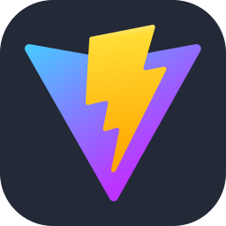
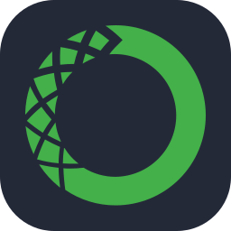
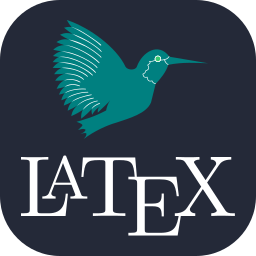
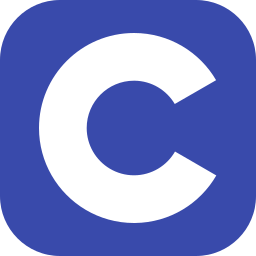
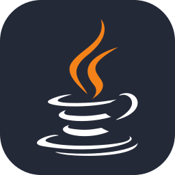
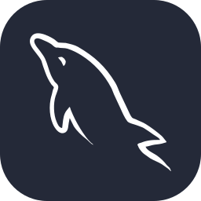
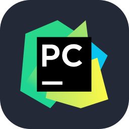
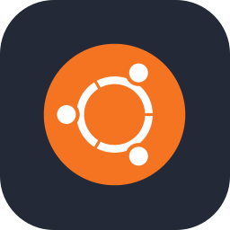
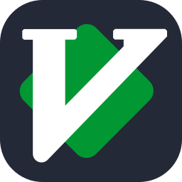
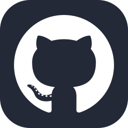

# Hi, I'm Louaq 👋

**Developer · Open-source builder · Computer vision enthusiast**

I build tools for technical writing and reading, working with **TypeScript, Astro, and Svelte** on the web and **Python and PyTorch** for image analysis. My research interests include multimodal learning and medical image segmentation.

  
  
  

## 🚀 Featured project

<table>
  <tr>
    <td width="45%" valign="top">
      <h3>📝 <a href="https://github.com/Louaq/Folumio">Folumio ↗</a></h3>
      
A personal blog customized from Firefly for technical writing and deep reading.

      

        
        
        
        
      

      
<a href="https://github.com/Louaq/Folumio">Explore the code</a> · <a href="https://louaq.io">Live site</a>

    </td>
    <td width="55%" valign="top">
      <h3>🔧 Inside the project</h3>
      
<b>✍️ Writing experience</b> Markdown / MDX, math typesetting, code highlighting, and PDF previews.

      
<b>🔎 Search &amp; navigation</b> Meilisearch integration and page transitions with Swup.

      
<b>⚡ Performance</b> On-demand loading and Chinese font subsetting.

    </td>
  </tr>
</table>

## 🛠️ Tech stack

**🌐 Web development**

  
  
  
  
  
  
  

**🧠 AI & scientific computing**

  
  
  
  
  

**💻 Languages & data**

  
  
  
  

**⚙️ Development workflow**

  
  
  
  
  
  
  
  

## 📚 Notes & exploration

I share technical notes and paper reading notes on [my blog](https://louaq.io). Alongside web development, I explore computer vision and medical image analysis.

  
🔬 Medical imaging · Selected paper reading notes

- [Inter-instance information complementarity for semi-supervised segmentation](https://louaq.io/posts/b5fb4f764ab4/)
- [Semantic transfer for semi-supervised medical image segmentation](https://louaq.io/posts/0a8526a42597/)

## 🐍 Contributions

<picture>
  <source media="(prefers-color-scheme: dark)" srcset="https://raw.githubusercontent.com/Louaq/Louaq/output/github-contribution-grid-snake-dark.svg" />
  <source media="(prefers-color-scheme: light)" srcset="https://raw.githubusercontent.com/Louaq/Louaq/output/github-contribution-grid-snake.svg" />
  
</picture>

<!-- Layout inspiration: https://github.com/abhisheknaiidu/awesome-github-profile-readme and https://github.com/tw93/tw93. -->
