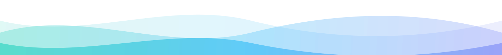

<h1 align="center">Hi, I'm Louaq 👋</h1>

**Developer · Open-source builder · Computer vision enthusiast**

I build tools for technical writing and reading, working with **TypeScript, Astro, and Svelte** on the web and **Python and PyTorch** for image analysis. My research interests include multimodal learning and medical image segmentation.

  
  
  

## 🚀 Featured projects

<table>
  <tr>
    <td width="55%" valign="top">
      <h3>📝 <a href="https://github.com/Louaq/Folumio">Folumio ↗</a></h3>
      
A personal blog customized from Firefly for technical writing and deep reading.

    </td>
    <td width="45%" valign="top">
      

  
  
  
  
      

      
<a href="https://github.com/Louaq/Folumio">Code</a> &middot; <a href="https://louaq.io">Live site</a>

    </td>
  </tr>
  <tr>
    <td width="55%" valign="top">
      <h3>📡 <a href="https://github.com/Louaq/sts-status">sts-status ↗</a></h3>
      
A service status page based on sts, integrating Gatus monitoring with incident management.

    </td>
    <td width="45%" valign="top">
      

  
  
  
  
      

      
<a href="https://github.com/Louaq/sts-status">Code</a>

    </td>
  </tr>
  <tr>
    <td width="55%" valign="top">
      <h3>🧮 <a href="https://github.com/Louaq/TexStudio">TexStudio ↗</a></h3>
      
A desktop app for recognizing LaTeX formulas from screenshots and images using the SimpleTex API.

    </td>
    <td width="45%" valign="top">
      

  
  
  
      

      
<a href="https://github.com/Louaq/TexStudio">Code</a> &middot; <a href="https://github.com/Louaq/TexStudio/releases">Downloads</a>

    </td>
  </tr>
</table>

## 🛠️ Tech stack

**🌐 Web development**

  
  
  
  
  
  
  

**🧠 AI & scientific computing**

  
  
  
  
  

**💻 Languages & data**

  
  
  
  

**⚙️ Development workflow**

  
  
  
  
  
  
  
  

## 🐍 Contributions
<picture>
  <source media="(prefers-color-scheme: dark)" srcset="https://raw.githubusercontent.com/Louaq/Louaq/output/github-contribution-grid-snake-dark.svg" />
  <source media="(prefers-color-scheme: light)" srcset="https://raw.githubusercontent.com/Louaq/Louaq/output/github-contribution-grid-snake.svg" />
  
</picture>

  <b>Thanks for visiting! 👋</b> 
  Keep building. Keep learning.

  

